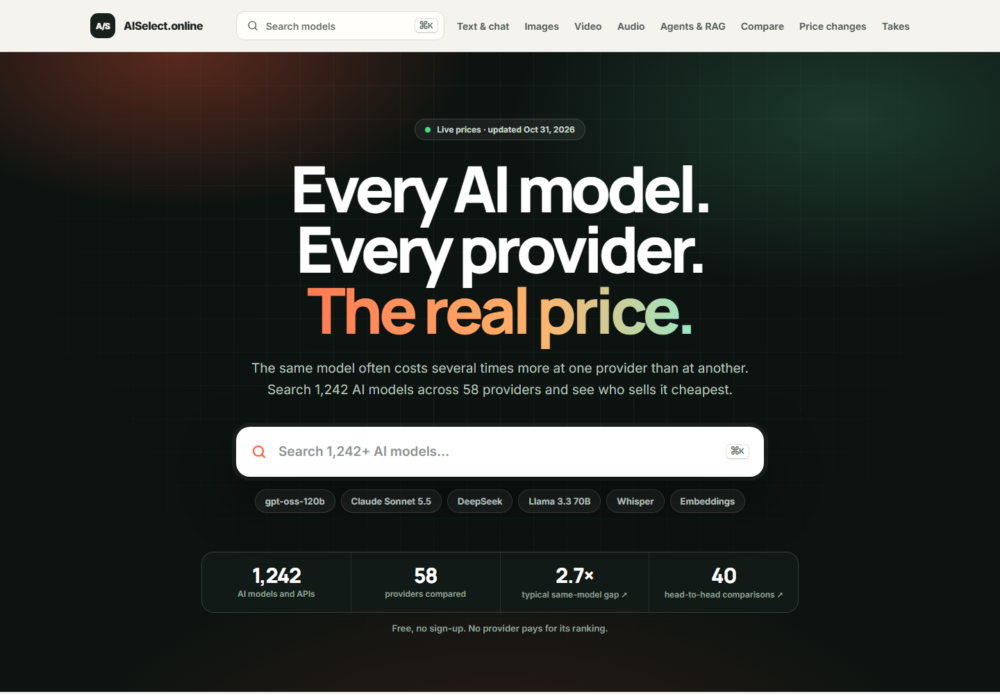
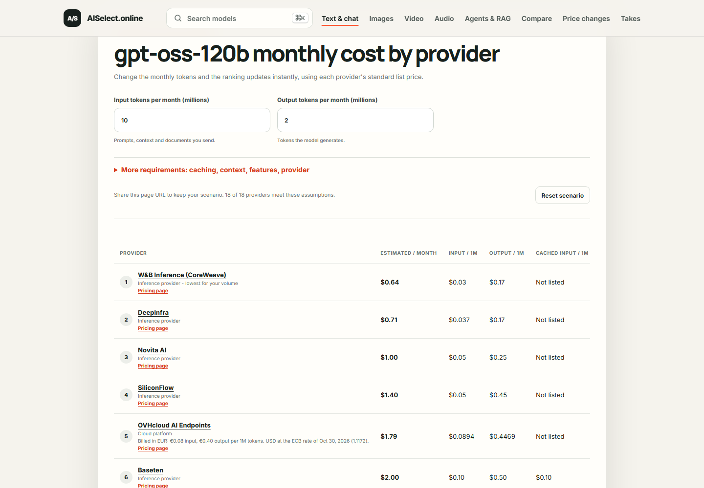
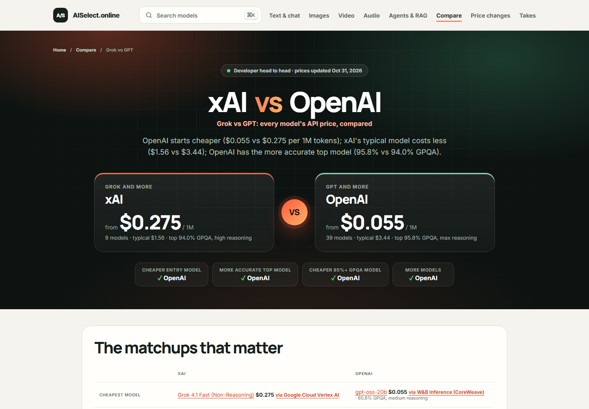
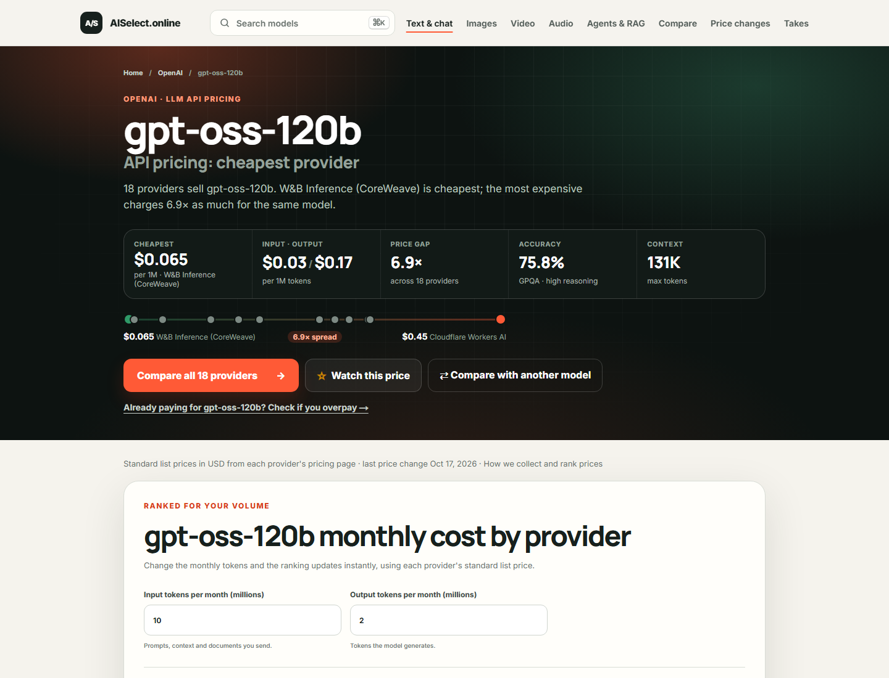
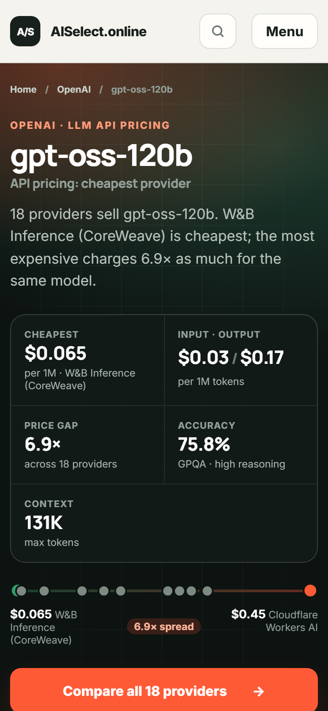

<div align="center">

<a href="https://aiselect.online"></a>

# AI API prices

**A free, daily-updated dataset of AI API list prices across 58 providers.**
LLMs, image and video generation, speech-to-text, text-to-speech, web search and embeddings, in one JSON and one CSV file.

[](https://github.com/Liutasil501/ai-api-prices/commits/main)
[](LICENSE)
[](https://aiselect.online)

[**Explore the data**](https://aiselect.online) · [JSON](ai-api-prices.json) · [CSV](ai-api-prices.csv) · [Price changes](https://aiselect.online/changes) · [Methodology](https://aiselect.online/methodology)

</div>

## Why this exists

The same open-weight model often costs several times more at one provider than at another, and nobody publishes those prices side by side. This repository does, every day, as plain files you can load into a spreadsheet, a notebook or your own app.

<!-- stats:start -->
**2,110 prices** for **1,239 models** from **59 providers**, last updated **2026-11-08**.

| Category | Prices | Models | Providers |
|---|---:|---:|---:|
| LLM / text | 1,791 | 1,002 | 38 |
| Image generation | 115 | 79 | 10 |
| Video generation | 60 | 40 | 9 |
| Speech-to-text | 10 | 9 | 7 |
| Text-to-speech | 32 | 30 | 8 |
| Web search | 20 | 7 | 14 |
| Embeddings | 82 | 72 | 16 |
<!-- stats:end -->

## Same model, very different price

The ten most widely sold models today, from the cheapest to the most expensive provider:

<!-- gaps:start -->
| Model | Providers | Cheapest | Typical | Most expensive | Gap |
|---|---:|---|---:|---|---:|
| [gpt-oss-120b](https://aiselect.online/models/gpt-oss-120b) | 20 | W&B Inference (CoreWeave) $0.065 | $0.26 | Cloudflare Workers AI $0.45 | **6.9×** |
| [GLM-5.2](https://aiselect.online/models/glm-5-2) | 14 | W&B Inference (CoreWeave) $1.07 | $2.15 | Scaleway $3.04 | **2.8×** |
| [Llama-3.3-70B-Instruct](https://aiselect.online/models/llama3-3-70b-instruct) | 14 | Nebius Token Factory $0.20 | $0.72 | Scaleway $1.00 | **5.1×** |
| [GLM-5.3](https://aiselect.online/models/glm-5-3) | 13 | GMI Cloud $1.07 | $2.15 | Amazon Bedrock $2.58 | **2.4×** |
| [GLM-5.3-Flash](https://aiselect.online/models/glm-5-3-flash) | 12 | GMI Cloud $0.12 | $0.24 | Z.ai $0.24 | **2.0×** |
| [DeepSeek V4 Flash 0731](https://aiselect.online/models/deepseek-v4-flash-0731) | 11 | DeepInfra $0.090 | $0.43 | Novita AI $0.66 | **7.3×** |
| [gpt-oss-20b](https://aiselect.online/models/gpt-oss-20b) | 11 | W&B Inference (CoreWeave) $0.055 | $0.075 | Cloudflare Workers AI $0.23 | **4.1×** |
| [Kimi K3](https://aiselect.online/models/kimi-k3) | 11 | SiliconFlow $5.40 | $6.00 | Together AI $6.00 | **1.1×** |
| [DeepSeek-V4.1-Flash](https://aiselect.online/models/deepseek-v4-1-flash) | 10 | DeepInfra $0.21 | $0.52 | Together AI $0.52 | **2.5×** |
| [DeepSeek V4.1 Flash 1017](https://aiselect.online/models/deepseek-v4-1-flash-1017) | 10 | DeepInfra $0.21 | $0.52 | Together AI $0.52 | **2.5×** |

*Blended list price per 1M tokens (3 input : 1 output), standard tier. The ten models sold by the most providers; typical is the median provider.*
<!-- gaps:end -->

## What it looks like on AISelect.online

The website turns this dataset into calculators, rankings and head-to-head comparisons.

<table>
  <tr>
    <td width="50%"><a href="https://aiselect.online/models/gpt-oss-120b"></a><br><sub><b>Your monthly cost at every provider.</b> Enter your token volume, get a ranking.</sub></td>
    <td width="50%"><a href="https://aiselect.online/compare/xai-vs-openai"></a><br><sub><b>Head to head.</b> Grok vs GPT, Claude vs Gemini and more, with accuracy next to price.</sub></td>
  </tr>
  <tr>
    <td width="50%"><a href="https://aiselect.online/models/gpt-oss-120b"></a><br><sub><b>Every model page.</b> Cheapest provider, price spread, GPQA accuracy, context.</sub></td>
    <td width="50%" align="center"><a href="https://aiselect.online"></a><br><sub><b>Works on a phone.</b> No sign-up, no paid rankings.</sub></td>
  </tr>
</table>

## Use it

**curl + jq**: every provider of one model, cheapest first

```bash
curl -s https://raw.githubusercontent.com/Liutasil501/ai-api-prices/main/ai-api-prices.json \
  | jq '[.prices[] | select(.model_slug=="gpt-oss-120b")] | sort_by(.input_usd_per_1m_tokens) | .[] | {provider, input_usd_per_1m_tokens, output_usd_per_1m_tokens}'
```

**Python / pandas**

```python
import pandas as pd

prices = pd.read_csv("https://raw.githubusercontent.com/Liutasil501/ai-api-prices/main/ai-api-prices.csv")
llm = prices[prices.category == "text"]
print(llm.groupby("model")["provider"].nunique().sort_values(ascending=False).head(10))
```

**JavaScript**

```js
const { prices } = await fetch("https://raw.githubusercontent.com/Liutasil501/ai-api-prices/main/ai-api-prices.json").then((r) => r.json());
const cheapest = prices.filter((p) => p.model_slug === "claude-sonnet-5-5").sort((a, b) => a.input_usd_per_1m_tokens - b.input_usd_per_1m_tokens)[0];
```

**Price history:** the commit history is the price history. `git log -p ai-api-prices.csv` shows every change since tracking started.

## Ask your AI assistant (MCP server)

This repository is also an [MCP](https://modelcontextprotocol.io) server, so Claude, Cursor or any MCP client can answer "what does gpt-oss-120b cost at each provider?" from today's data. It reads the daily file from aiselect.online (this repository's copy as fallback); no API key, no sign-up. Needs Node.js 18 or newer.

| Tool | Answers |
|---|---|
| `find_models` | Which models match "claude sonnet", with each one's cheapest provider |
| `model_prices` | Every provider of one model, cheapest first, with input, output and cached prices and the pricing page |
| `estimate_monthly_cost` | Your monthly bill at every provider, for tokens (LLMs) or images, video seconds, audio hours, characters or searches |
| `compare_models` | Two models side by side on their cheapest price |
| `cheapest_models` | The cheapest models in a category (LLM, image, video, speech, TTS, search, embeddings) |

**Claude Code**

```bash
claude mcp add ai-api-prices -- npx -y github:Liutasil501/ai-api-prices
```

**Claude Desktop, Cursor and other clients** (`claude_desktop_config.json`, `.cursor/mcp.json`):

```json
{
  "mcpServers": {
    "ai-api-prices": { "command": "npx", "args": ["-y", "github:Liutasil501/ai-api-prices"] }
  }
}
```

Then ask: *"Which provider sells Llama 3.3 70B cheapest, and what would 50M input and 10M output tokens a month cost there?"*

## Columns

| Column | Meaning |
|---|---|
| `category` | `text`, `image`, `video`, `transcription`, `tts`, `search`, `embedding` |
| `model`, `model_slug` | Model name and a stable slug |
| `provider`, `provider_id`, `provider_type` | Who sells it: `first_party`, `cloud` or `inference_host` |
| `input_usd_per_1m_tokens`, `output_usd_per_1m_tokens`, `cached_input_usd_per_1m_tokens` | Token prices |
| `usd_per_image`, `usd_per_video_second`, `usd_per_audio_hour` | Media prices |
| `usd_per_1k_searches`, `usd_per_1m_characters` | Web search (one query, up to 10 results) and text-to-speech |
| `context_tokens`, `variant` | Context window and billing variant, where known |
| `source_url`, `source_dataset` | The provider's pricing page and the open dataset the value came from |
| `first_seen`, `last_changed`, `last_confirmed` | Dates (UTC) |

## How prices get in

Prices come from open, MIT-licensed datasets ([LiteLLM](https://github.com/BerriAI/litellm), [models.dev](https://github.com/sst/models.dev), [Portkey Models](https://github.com/Portkey-AI/models)) and from pricing pages checked by hand. Before a value is published it has to pass guards:

- it must appear on two consecutive daily runs,
- a jump above 50% is published only after it holds for seven days, and zero prices and 10x jumps are skipped as dataset errors,
- every provider is classified by hand (resellers and gateways are not listed as providers),
- prices billed in euros are converted to US dollars at the European Central Bank's daily rate.

These are standard list prices, not quotes. Batch, committed-use and negotiated discounts are not included. Check the provider's page before you buy. The full method is on the [methodology page](https://aiselect.online/methodology).

## License and credit

MIT. If you publish something built on this data, please credit **AISelect.online** and link <https://aiselect.online/open-data>. The source datasets and their licenses are listed in [THIRD_PARTY_NOTICES.md](THIRD_PARTY_NOTICES.md).

Found a wrong price? [Open an issue](https://github.com/Liutasil501/ai-api-prices/issues) with a link to the provider's pricing page.
